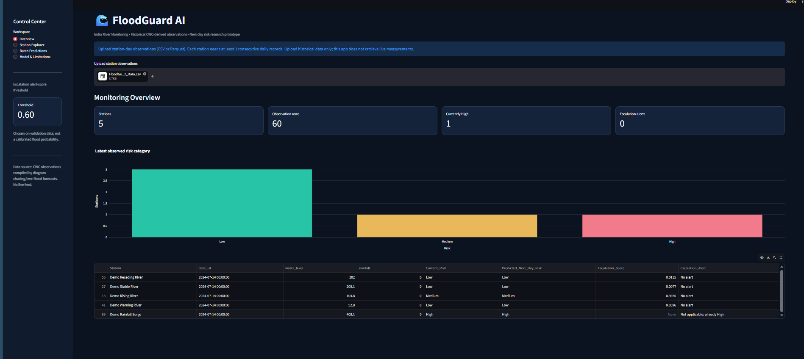
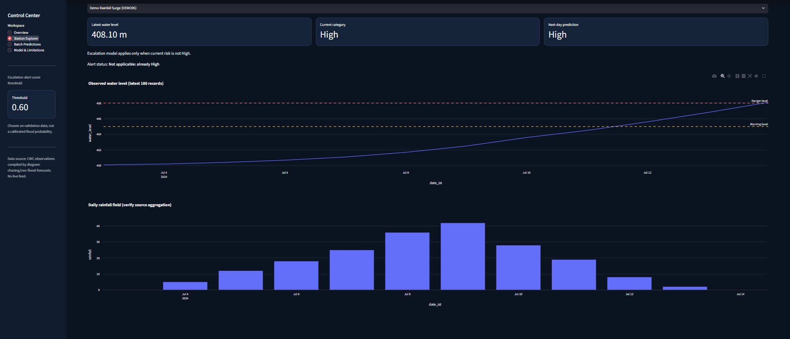
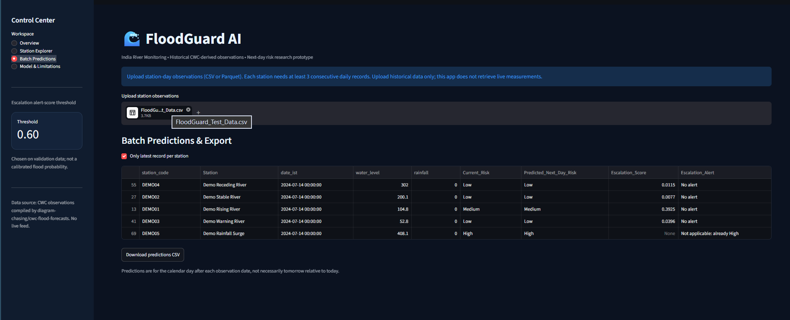
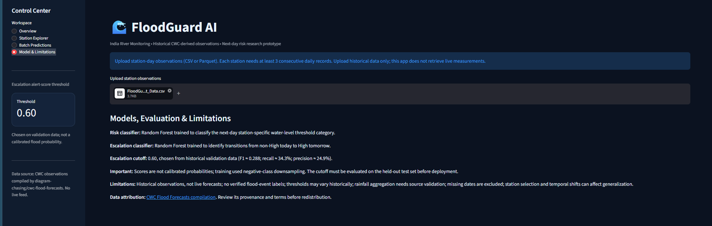

# 🌊 FloodGuard AI — River Flood Risk Intelligence

**Historical river monitoring | Next-day risk classification | Escalation alerts | Streamlit**

FloodGuard AI is a machine-learning research prototype that analyzes historical Indian river-station observations and estimates **next-day water-level risk categories**. It combines an interactive monitoring dashboard with two Random Forest models: one for classifying next-day risk and another for detecting possible transitions into **High Risk**.

> **Research prototype, not an official flood warning system.** Predictions represent station-specific water-level threshold categories, **not verified flood events**. The application does not fetch live measurements, and its escalation scores are not calibrated flood probabilities.

## ✨ Features

- **Monitoring overview:** station counts, observation summaries, latest risk categories and alerts.
- **Station explorer:** historical water-level and rainfall charts with warning and danger thresholds.
- **Next-day classification:** predicted **Low / Medium / High** risk categories.
- **Escalation detection:** flags possible transitions from non-High today to High tomorrow.
- **Batch predictions:** upload CSV/Parquet station-day records and export results as CSV.
- **Model transparency:** methodology, evaluation figures, limitations and source attribution.

## 📸 Dashboard Screenshots

### 1. Monitoring Overview


### 2. Station Explorer


### 3. Batch Predictions and Export


### 4. Model Evaluation and Limitations


*Screenshots show a synthetic demonstration CSV, not live or verified flood observations.*

## 🧠 Machine Learning

| Model | Algorithm | Task |
|---|---|---|
| Next-day risk classifier | Random Forest | Predict Low, Medium or High risk |
| Risk escalation classifier | Random Forest | Detect non-High → High transitions |

**Model inputs:** current water level, rainfall, previous-day rainfall, previous-day water level, water-level change, rolling three-day rainfall, and distances to warning/danger thresholds.

**Risk categories:** Low (below warning level), Medium (at/above warning but below danger), High (at/above danger).

### Evaluation

| Evaluation | Metric | Result |
|---|---|---:|
| Next-day risk classifier — chronological test | Accuracy | 97.91% |
| Next-day risk classifier — chronological test | High-risk F1 | 0.85 |
| Risk escalation classifier — historical validation, cutoff 0.60 | Precision | 24.9% |
| Risk escalation classifier — historical validation, cutoff 0.60 | Recall | 34.3% |
| Risk escalation classifier — historical validation, cutoff 0.60 | F1 | 0.288 |

The persistence baseline (tomorrow's risk = today's risk) achieved **98.59% accuracy** on the next-day risk test set, higher than the three-class Random Forest's overall accuracy. The separate escalation model is intended to focus on rare newly emerging High Risk cases. **The retrained escalation model's final held-out test performance has not yet been reported**, so the validation metrics above should not be described as final test results.

The **0.60 cutoff** was selected from historical validation results, not from calibrated probabilities. It still misses many emerging High Risk cases and requires further evaluation before operational use.

## 🗂️ Dataset

Historical Central Water Commission (CWC)-derived station observations, accessed through the third-party [CWC Flood Forecasts compilation](https://github.com/diagram-chasing/cwc-flood-forecasts).

- Station-specific water levels, rainfall observations and warning/danger thresholds.
- Training preparation produced approximately **3.86 million** consecutive-day labeled examples from **932 stations**.
- Training and testing used a chronological split (initial test period beginning **2023-12-03**).
- Uploaded sample CSVs and the screenshots are **synthetic demonstrations**.

Please review source provenance, aggregation conventions and redistribution terms before publishing original data or trained models. In particular, the interpretation of daily rainfall aggregation still needs validation.

## 🚀 Run Locally

```bash
python -m pip install -r requirements.txt
python -m streamlit run app.py
```

Export your trained models from the original Google Colab notebook:

```python
import joblib
joblib.dump(model, "risk_model.joblib")
joblib.dump(escalation_model, "escalation_model.joblib")
```

Place them in `models/`:

```text
FloodGuard-AI/
├── app.py
├── requirements.txt
├── README.md
├── models/
│   ├── risk_model.joblib
│   └── escalation_model.joblib
├── sample_data/
│   └── FloodGuard_Test_Data.csv
└── screenshots/
    ├── D1.png
    ├── D2.png
    ├── D3.png
    └── D4.png
```

Upload a CSV or Parquet file with station-day observations (at least three consecutive daily records per station) in the app. Historical predictions are for the day **after each observation date**, not necessarily tomorrow relative to the current date.

## 🛠️ Tech Stack

**Python · Pandas · NumPy · scikit-learn · Streamlit · Plotly · Joblib**

## ⚠️ Limitations

- Not a live alert feed or official emergency-warning product.
- Risk labels are derived from station-specific thresholds rather than confirmed flood damage/events.
- Training used negative-class downsampling; escalation scores are **not calibrated probabilities**.
- Some station thresholds may have changed historically; rainfall aggregation needs source-level verification.
- Missing-day sequences are excluded; results may vary across stations and time periods.
- The escalation model has limited recall and can produce false alerts; human review and additional validation are necessary.

## 📚 Data Attribution

[CWC Flood Forecasts — historical data compilation](https://github.com/diagram-chasing/cwc-flood-forecasts) (third-party compilation of CWC-derived observations).
